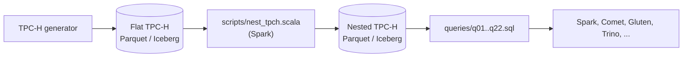
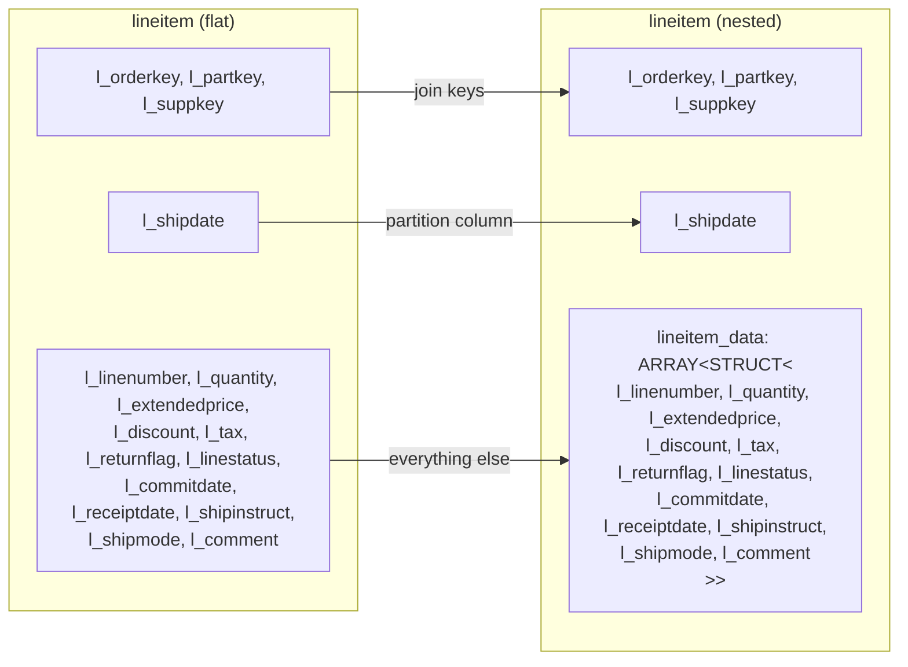

<!--
Licensed to the Apache Software Foundation (ASF) under one
or more contributor license agreements.  See the NOTICE file
distributed with this work for additional information
regarding copyright ownership.  The ASF licenses this file
to you under the Apache License, Version 2.0 (the
"License"); you may not use this file except in compliance
with the License.  You may obtain a copy of the License at

  http://www.apache.org/licenses/LICENSE-2.0

Unless required by applicable law or agreed to in writing,
software distributed under the License is distributed on an
"AS IS" BASIS, WITHOUT WARRANTIES OR CONDITIONS OF ANY
KIND, either express or implied.  See the License for the
specific language governing permissions and limitations
under the License.
-->

# Nested Benchmark Derived from TPC-H

TPC-H data and queries with a nested schema, for benchmarking how engines handle nested data.
The queries are derived from TPC-H under the TPC Fair Use Policy.

## Motivation

TPC-H is flat. All eight tables are normalized and every column is primitive. Real-world
data usually isn't: event logs, JSON/Avro/Protobuf records and data lake tables are full of
structs and arrays. Nested column pruning, struct predicate pushdown and array unnesting
are hot paths in practice, but flat TPC-H exercises none of them.

Nested TPC-H closes that gap. It keeps the TPC-H data and queries and changes only the
shape. Each array holds exactly one element, so the nested queries return the same answers
as the flat ones.



## Schema

Join keys and partition columns stay at the top level. All other columns move into
`<table>_data: array<struct<...>>`.



For example, `lineitem`. The keys `l_orderkey`, `l_partkey` and `l_suppkey` and the
partition column `l_shipdate` stay at the top level. The rest moves into `lineitem_data`.

Flat:

```
l_orderkey       BIGINT
l_partkey        BIGINT
l_suppkey        BIGINT
l_linenumber     INT
l_quantity       DECIMAL(12,2)
l_extendedprice  DECIMAL(12,2)
l_discount       DECIMAL(12,2)
l_tax            DECIMAL(12,2)
l_returnflag     STRING
l_linestatus     STRING
l_shipdate       DATE
l_commitdate     DATE
l_receiptdate    DATE
l_shipinstruct   STRING
l_shipmode       STRING
l_comment        STRING
```

Nested:

```
l_orderkey     BIGINT
l_partkey      BIGINT
l_suppkey      BIGINT
l_shipdate     DATE
lineitem_data  ARRAY<STRUCT<
    l_linenumber: INT,
    l_quantity: DECIMAL(12,2),
    l_extendedprice: DECIMAL(12,2),
    l_discount: DECIMAL(12,2),
    l_tax: DECIMAL(12,2),
    l_returnflag: STRING,
    l_linestatus: STRING,
    l_commitdate: DATE,
    l_receiptdate: DATE,
    l_shipinstruct: STRING,
    l_shipmode: STRING,
    l_comment: STRING>>
```

The other tables follow the same rule. The partition columns are `p_brand` (`part`),
`c_mktsegment` (`customer`), `o_orderdate` (`orders`) and `l_shipdate` (`lineitem`).

Source columns are cast to fixed types: `BIGINT` keys, `DECIMAL(12,2)` money, `DATE`,
`STRING`. Output is written with zstd compression and 512 MiB row groups. Run the script
with `dryRun=true` to print the full DDL.

## Prerequisites

- An already generated flat TPC-H dataset in Parquet or Iceberg. If you don't have one,
  generate it with [tpcgen-cli](https://github.com/datafusion-contrib/tpcgen-rs)
  (`tpcgen-cli tpch parquet -s 100 --output-dir /data/tpch/sf100`) or
  [tpch-dbgen](https://github.com/databricks/tpch-dbgen). Parquet tables are read from
  `<path>/<table>/` or `<path>/<table>.parquet`.
- Apache Spark 3.5+ (tested with 3.5.5 and 4.1.1), local or on a cluster sized for your
  scale factor. For Iceberg, add the matching `iceberg-spark-runtime` package.

## Usage

TPC-H goes up to SF10000, which is about 10 TB and 60 billion `lineitem` rows. Converting
data at that size can be expensive, so it needs a distributed engine that reads and writes
Parquet and Iceberg natively on any storage. This benchmark uses Apache Spark for the conversion. The same
script runs on a laptop or a cluster.

Run the commands below from `benchmarks/nested`. The script needs no build step.

Parquet to Parquet:

```bash
spark-shell -i scripts/nest_tpch.scala \
  --conf spark.nesttpch.source=parquet:/data/tpch/sf10 \
  --conf spark.nesttpch.target=parquet:/data/tpch-nested/sf10
```

Parquet to Iceberg. Any Iceberg catalog works:

```bash
spark-shell \
  --packages org.apache.iceberg:iceberg-spark-runtime-3.5_2.12:1.8.1 \
  --conf spark.sql.catalog.nested=org.apache.iceberg.spark.SparkCatalog \
  --conf spark.sql.catalog.nested.type=hadoop \
  --conf spark.sql.catalog.nested.warehouse=s3a://bucket/warehouse \
  -i scripts/nest_tpch.scala \
  --conf spark.nesttpch.source=parquet:s3a://bucket/tpch/sf1000 \
  --conf spark.nesttpch.target=iceberg:nested.tpch
```

For an Iceberg source, use `spark.nesttpch.source=iceberg:<catalog>.<db>`.

| Setting                      | Default    | Description                                     |
| ---------------------------- | ---------- | ----------------------------------------------- |
| `spark.nesttpch.source`      | (required) | `parquet:<path>` or `iceberg:<catalog>.<db>`    |
| `spark.nesttpch.target`      | (required) | Same forms                                      |
| `spark.nesttpch.tables`      | all        | Comma separated subset, e.g. `region,nation`    |
| `spark.nesttpch.partitioned` | `true`     | Partition by the partition columns listed above |
| `spark.nesttpch.overwrite`   | `true`     | Replace existing target tables                  |
| `spark.nesttpch.verify`      | `true`     | Check source and target row counts              |
| `spark.nesttpch.dryRun`      | `false`    | Print the DDL only                              |

For SF1000 and above, set `spark.sql.shuffle.partitions` to a few thousand.

## Queries

The queries refer to tables by their bare TPC-H names. Each query unnests the arrays it
needs:

```sql
from (select l_orderkey, l_partkey, l_suppkey, l_shipdate,
             explode(lineitem_data) as lineitem_data from lineitem) as lineitem
where lineitem_data.l_quantity < 24
```

To run them in `spark-shell`:

```scala
Seq("region", "nation", "supplier", "part", "partsupp", "customer", "orders", "lineitem")
  .foreach(t => spark.read.parquet(s"/data/tpch-nested/sf10/$t").createOrReplaceTempView(t))
spark.sql(scala.io.Source.fromFile("queries/q01.sql").mkString).show()
```

TPC-H is a trademark of the TPC. Results from these queries are not TPC-H results.
