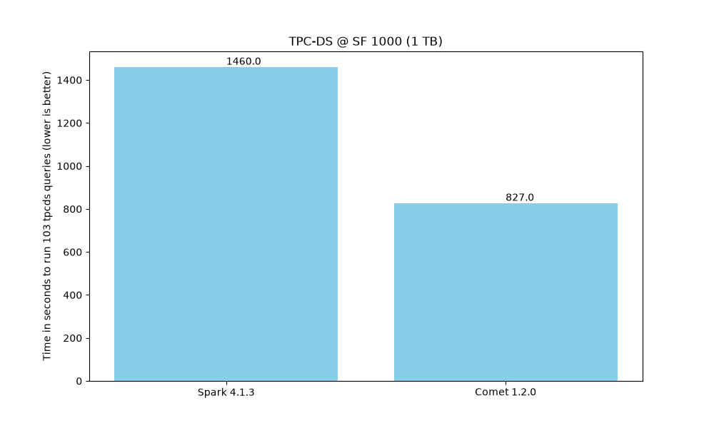
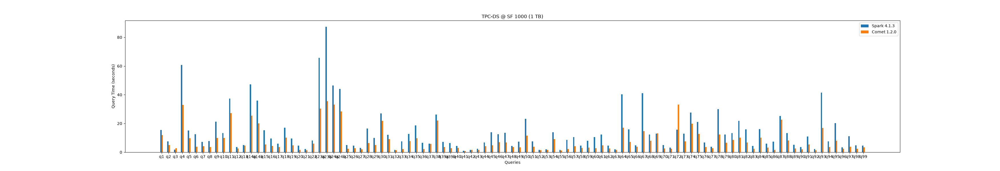
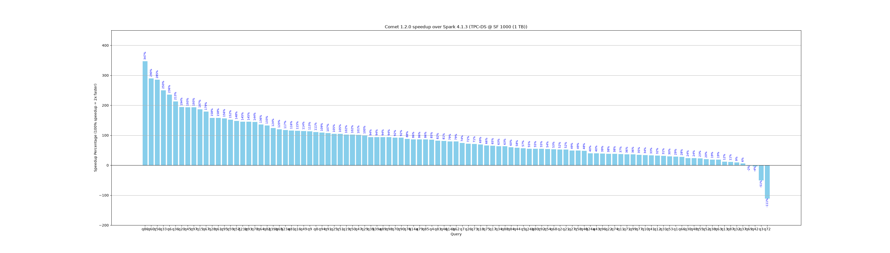
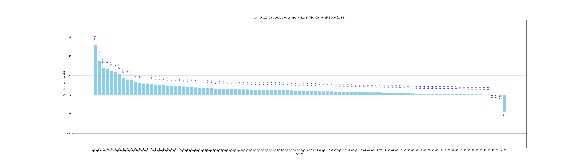
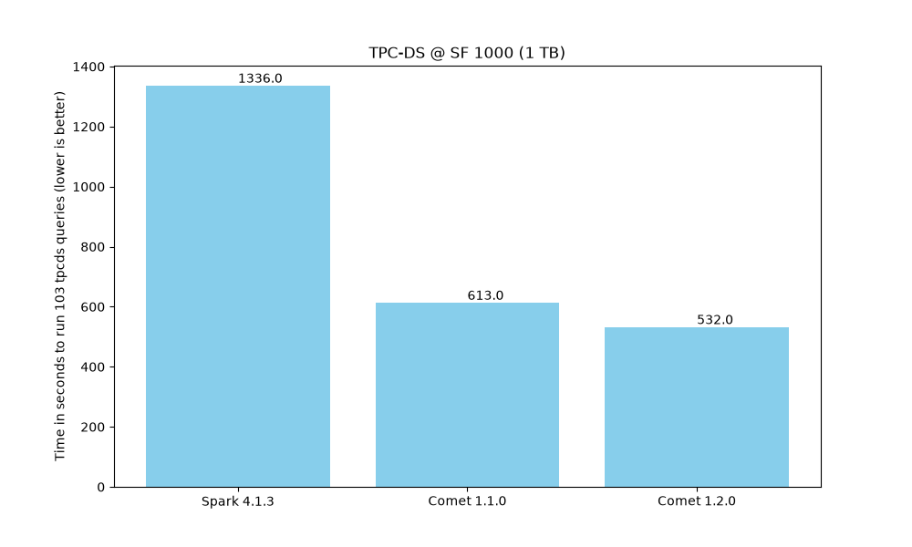
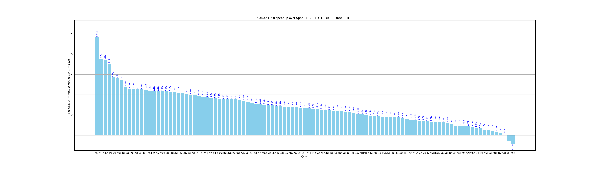

<!--
Licensed to the Apache Software Foundation (ASF) under one
or more contributor license agreements.  See the NOTICE file
distributed with this work for additional information
regarding copyright ownership.  The ASF licenses this file
to you under the Apache License, Version 2.0 (the
"License"); you may not use this file except in compliance
with the License.  You may obtain a copy of the License at

  http://www.apache.org/licenses/LICENSE-2.0

Unless required by applicable law or agreed to in writing,
software distributed under the License is distributed on an
"AS IS" BASIS, WITHOUT WARRANTIES OR CONDITIONS OF ANY
KIND, either express or implied.  See the License for the
specific language governing permissions and limitations
under the License.
-->

# TPC-DS

The following benchmarks were performed on an EKS cluster (`r6i` instances with EBS storage) with data stored in S3,
using Apache Spark 4.2.0 (Scala 2.13), Comet 1.1.0 and Comet 1.2.0. The tables are Parquet files compressed with zstd at
scale factor 1000 (1 TB), and all three runs read the same files. Each query was run twice and the mean time is reported.

Across all 103 queries, Comet 1.2.0 finished in 488 seconds, Comet 1.1.0 in 525 seconds and Spark in 994 seconds,
so Comet 1.2.0 is 2.0x faster than Spark and 1.1x faster than Comet 1.1.0. The Comet 1.1.0 results are the ones
published previously.

## Benchmark Results

Total time to run all queries (lower is better).



Per-query breakdown showing the relative performance of Spark and Comet.



How much Comet 1.2.0 accelerates each query over Spark in relative terms.



How much Comet 1.2.0 accelerates each query over Spark in absolute terms.



## Spark 4.1.3

The same tables and settings were also run with Apache Spark 4.1.3 (Scala 2.13).

|             | Total time (103 queries) | Speedup over Spark |
| ----------- | ------------------------ | ------------------ |
| Spark 4.1.3 | 1,336 s                  |                    |
| Comet 1.1.0 | 613 s                    | 2.18x              |
| Comet 1.2.0 | 532 s                    | 2.51x              |

Spark 4.1.3 is slower than Spark 4.2.0 on this cluster (1,336 s vs 994 s), so the speedups are larger than with Spark 4.2.0.
Comet 1.2.0's time differs by about 10% between the two Spark versions (532 s vs 488 s). See
[#7451](https://github.com/apache/datafusion-comet/issues/7451) for the investigation.

Total time to run all queries (lower is better).



How much Comet 1.2.0 accelerates each query over Spark 4.1.3 in relative terms.



## Configuration

Only settings that differ from the defaults are listed. Comet 1.1.0 and Comet 1.2.0 used the same settings.

Common:

```properties
spark.driver.memory=128G
spark.driver.maxResultSize=16g
spark.executor.instances=32
spark.executor.cores=16
spark.memory.fraction=0.6
spark.memory.storageFraction=0.2
spark.sql.shuffle.partitions=512
spark.sql.broadcastTimeout=900
spark.sql.sources.ignoreDataLocality=true
spark.hadoop.parquet.io.stats.enabled=false
spark.hadoop.fs.s3a.connection.maximum=5000
spark.hadoop.fs.s3a.threads.max=20
spark.hadoop.fs.s3a.vectored.read.min.seek.size=128K
spark.hadoop.fs.s3a.vectored.read.max.merged.size=2M
# Kubernetes CPU constraints
spark.kubernetes.driver.request.cores=32
spark.kubernetes.driver.limit.cores=32
spark.kubernetes.executor.request.cores=8
spark.kubernetes.executor.limit.cores=8
```

Spark:

```properties
spark.executor.memory=64G
spark.executor.memoryOverhead=10G
```

Comet:

```properties
spark.executor.memory=64G
spark.executor.memoryOverhead=10G
spark.memory.offHeap.enabled=true
spark.memory.offHeap.size=32G
spark.plugins=org.apache.spark.CometPlugin
spark.shuffle.manager=org.apache.spark.sql.comet.execution.shuffle.CometShuffleManager
spark.sql.extensions=org.apache.comet.CometSparkSessionExtensions
spark.comet.exec.memoryPool.fraction=0.8
```
