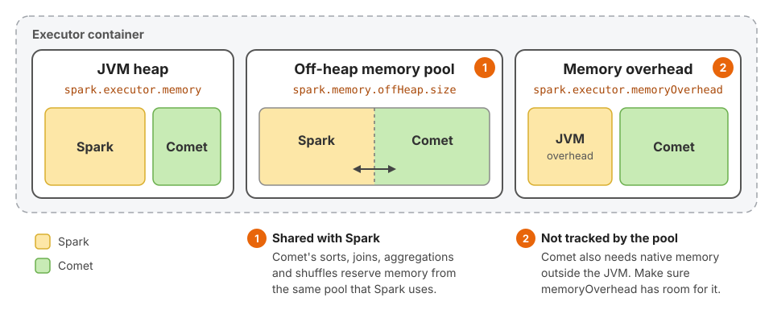

<!---
Licensed to the Apache Software Foundation (ASF) under one
or more contributor license agreements.  See the NOTICE file
distributed with this work for additional information
regarding copyright ownership.  The ASF licenses this file
to you under the Apache License, Version 2.0 (the
"License"); you may not use this file except in compliance
with the License.  You may obtain a copy of the License at

http://www.apache.org/licenses/LICENSE-2.0

Unless required by applicable law or agreed to in writing,
software distributed under the License is distributed on an
"AS IS" BASIS, WITHOUT WARRANTIES OR CONDITIONS OF ANY
KIND, either express or implied.  See the License for the
specific language governing permissions and limitations
under the License.
-->

# Memory Tuning

Comet needs two things configured: an off-heap pool for it to draw its reservations from, and enough executor memory
overhead to cover the part of its footprint that no pool tracks. See [Configuring Comet Memory] and
[Configuring Executor Memory Overhead]. To find out how much memory Comet uses on a real workload, see
[Sizing the Overhead from the Memory Usage Log].



[Configuring Comet Memory]: #configuring-comet-memory
[Configuring Executor Memory Overhead]: #configuring-executor-memory-overhead

## Configuring Comet Memory

Comet shares an off-heap memory pool with Spark. The size of the pool is
specified by `spark.memory.offHeap.size`. The pool is a shared _budget_ rather than a shared
allocator: Comet's native operators allocate from the Rust heap rather than from JVM off-heap
memory, but every reservation they make is charged against this same pool, so Comet and Spark's own
off-heap consumers draw down one number.

A larger pool lets the operators that can spill, such as sorts, aggregations and the shuffle writer, keep more in
memory before they spill to disk. An operator that cannot spill fails the task when it cannot reserve the memory it
needs. A native Iceberg fanout write is the exception: it closes some of its open files early instead (see
[Iceberg Writes](../iceberg.md#failure-handling)).

Comet's memory pool only tracks memory that an operator explicitly reserves, which in practice means the batches
an operator deliberately accumulates: the sort buffer, the build side of a hash join, hash aggregation state, the
shuffle writer's buffered partitions, and the files a native writer holds open. Memory that is not reserved is
invisible to the pool no matter how much of it there is. That includes:

- per-batch working memory in expression kernels and Arrow array builders,
- decompression buffers and Parquet reader structures,
- object store request buffers and the async runtime's own machinery,
- Arrow buffers allocated on the JVM side, which no budget covers at all,
- allocator overhead: buffer padding, size-class rounding, fragmentation, and pages the allocator retains after a
  free rather than returning to the operating system.

Reserved memory is therefore a lower bound on what Comet really uses, and how far below it sits depends on the
workload. This is why Comet can stay within the pool's limit and still push the executor past its container limit.
The part that is not counted has to fit in `spark.executor.memoryOverhead`, and each executor logs how large it is
while Comet runs; see [Sizing the Overhead from the Memory Usage Log].

`spark.comet.exec.memoryPool.fraction` is deprecated and does not leave room for it. Spark hands out all of
`spark.memory.offHeap.size` to the tasks that ask for it, whatever the fraction. The `fair_unified` pool applies the
fraction to each task separately, where Spark's own limit of an even share of the pool per running task is tighter
unless the fraction is below one over the number of running tasks, and the `greedy_unified` pool ignores it.

For more details about Spark off-heap memory mode, please refer to [Spark documentation].

[Spark documentation]: https://spark.apache.org/docs/latest/configuration.html

Comet implements multiple memory pool implementations. The type of pool can be specified with `spark.comet.exec.memoryPool`.

The valid pool types are:

- `fair_unified` (default when `spark.memory.offHeap.enabled=true` is set)
- `greedy_unified`

Both pool types are shared by all the native plans in the same Spark task. A task can run more than
one native plan at a time, for example the native operators on either side of a union or a
coalesce. The shared pool ensures that their combined memory usage stays within the per-task limit.

The `fair_unified` pool keeps memory for the operators that cannot spill, such as the final merge of a sort or the
build side of a hash join. Spark limits each task to an even share of `spark.memory.offHeap.size` among the tasks
using it, and the pool divides `spark.memory.offHeap.size` the same way among the tasks running native plans. Within
a task, it limits each operator that can spill to an even share of what the operators that cannot spill leave of the
task's share, counting the operators of all of the task's native plans. The operators that cannot spill take what
Spark grants. So an operator that can spill sometimes spills even when there is memory to spare, in order to leave it
for the task's other operators. A limit that small can be less than one batch of wide rows, and a sort cannot spill a
batch it has not yet reserved, so it then fails with "Not enough memory to continue external sort". Give the
executors more off-heap memory, lower `spark.comet.batchSize`, or use `greedy_unified`, which leaves every limit to
Spark.

The `greedy_unified` pool type implements a greedy first-come first-serve limit. This pool works well for queries that do not
need to spill or have a single spillable operator.

## Configuring Executor Memory Overhead

Enabling off-heap memory is not sufficient on its own. The cluster manager sizes the executor
container to include `spark.memory.offHeap.size`, so the memory that Comet's operators reserve has
room, but nothing in the container's size accounts for the memory that no pool tracks (see
[Configuring Comet Memory]). That memory has to fit in `spark.executor.memoryOverhead`, which the
JVM's own non-heap memory, such as metaspace, code cache, thread stacks and GC structures, is
already drawing on.

Work out what the executor already gets before choosing a value. When
`spark.executor.memoryOverhead` is unset, Spark derives the overhead as
`max(spark.executor.memoryOverheadFactor * spark.executor.memory, 384 MiB)`. The factor defaults to
`0.1`. On Kubernetes, when `spark.executor.memoryOverheadFactor` is unset, Spark uses
`spark.kubernetes.memoryOverheadFactor` instead, which also defaults to `0.1`, except for PySpark
and SparkR applications submitted in cluster mode, where it defaults to `0.4`. On Spark 4.0 and
later the floor is configurable through `spark.executor.minMemoryOverhead`. Setting
`spark.executor.memoryOverhead` **replaces** the derived value rather than adding to it, so a value
below what is derived today shrinks the container instead of growing it.

For a small executor, `2g` is a reasonable starting point. A 4 GiB executor derives only 409 MiB, so
this is a real increase:

```
spark.executor.memoryOverhead=2g
```

A 32 GiB executor, on the other hand, already derives 3276 MiB, and the same setting would take away
1228 MiB. For executors that large, either pick an absolute value above what is derived today, or
raise `spark.executor.memoryOverheadFactor` instead so that the overhead keeps scaling with executor
size:

```
spark.executor.memoryOverheadFactor=0.2
```

Raise the value further if executors are killed by the cluster manager (on Kubernetes,
`ExecutorLostFailure` with exit code 137) rather than failing with a task-level out-of-memory error.
To measure how much Comet needs rather than guessing, see [Sizing the Overhead from the Memory Usage Log].
If executors are killed while the memory usage log stays well inside the limits, raising the
overhead may only delay it; see [Returning Freed Native Memory to the Operating System].

Note that on Kubernetes and YARN the overhead is added to the container size, so raising it reduces
how many executors fit on a node. A standalone cluster ignores the overhead: its workers start
executors without a memory limit and count only `spark.executor.memory` against the memory they
offer.

[Sizing the Overhead from the Memory Usage Log]: #sizing-the-overhead-from-the-memory-usage-log

## Sizing the Overhead from the Memory Usage Log

While Comet native plans are running, each executor logs its native memory usage at INFO level,
one line every 10 seconds for the whole executor:

```
Comet native memory usage: allocated 5412.3 MiB, reserved 3890.0 MiB (16 native plans, 8 memory pools); JVM Arrow allocated 310.4 MiB, 96.2 MiB of it imported from native
```

- `allocated` is the memory allocated through Comet's Rust global allocator and not yet freed,
  whether or not a pool tracks it. It excludes allocations made by native libraries outside that
  allocator, including the embedded Python interpreter and PyArrow when native Arrow UDFs are
  enabled.
- `reserved` is the part that Comet's memory pools have reserved from Spark's off-heap memory. It is
  charged against `spark.memory.offHeap.size`, so the container already has room for it. A pool
  sometimes has to track memory that Spark could not grant, such as a spilled batch read back from
  disk while the off-heap memory is full. `reserved` leaves that memory out, since nothing charges it
  against `spark.memory.offHeap.size`.
- `JVM Arrow allocated` is the Arrow memory Comet holds on the JVM side, such as batches read from
  Comet's in-memory cache, broadcast data, and batches exchanged with native code or Python workers.
  The part imported from native was allocated by Comet's native code, so `allocated` already counts
  it, and the rest the JVM allocated itself. A pool reserves the JVM's part only while a native
  operator holds on to one of its batches, such as a sort buffering its input. The split follows
  which allocator a buffer is charged to rather than where it was allocated, so treat the JVM's
  part as an estimate.

When the application writes an event log and runs the Comet plugin, the event log also records a
summary of these samples; see [Reading the Memory Usage Log from the Event Log].

Comet's untracked memory is what Comet holds outside the JVM heap that Spark's off-heap pool does
not account for: `allocated`, plus the JVM Arrow figure less the part imported from native, minus
`reserved`. It is the part of Comet's footprint that has to fit in `spark.executor.memoryOverhead`,
alongside the JVM's own non-heap memory. To size the overhead from it:

1. Run a representative workload and find the line with the most untracked memory in each
   executor's log, or the event with the most for each executor in the event log. Take all the
   figures from the same line or event: they are sampled together, and figures from different
   samples describe different moments. Setting `spark.comet.memory.logInterval=1s` for this run
   makes a short-lived peak less likely to fall between samples.
2. Start from the overhead the executors had before Comet was enabled, which covers the JVM's own
   non-heap memory, and add the most untracked memory seen on any executor.
3. Add a margin on top. The log can miss the true peak between samples, and none of the figures
   includes the allocator's fragmentation and retained pages, or memory allocated by native C
   libraries such as zstd. With native Arrow UDFs, budget the embedded Python interpreter and
   PyArrow allocations in addition to the untracked memory calculated from the log. A PyArrow
   result buffer later imported into the JVM can appear in the `imported from native` figure that
   the estimate subtracts, even though Rust's `allocated` does not count it. Use the executor's
   peak resident memory to size this additional overhead.

For example, a 16 GiB executor derives an overhead of 1638 MiB. If the line above has the most
untracked memory in its log, that is 5412.3 + (310.4 - 96.2) - 3890.0 = 1736.5 MiB. The overhead
then needs to be at least 1638 + 1737 = 3375 MiB before any margin, so
`spark.executor.memoryOverhead=4g` would be a reasonable setting.

The executor also logs a warning when its native memory looks larger than its container allows:
when the untracked memory, plus everything in use in Spark's off-heap memory pool (which includes
Comet's reservations), exceeds `spark.memory.offHeap.size` plus the memory overhead. This counts the
part of the off-heap pool that nothing has acquired at that moment, which untracked memory can
occupy until Spark hands it out, so a quiet log is not a sign that the overhead is large enough:
size it from the most untracked memory as described above. The overhead also has to hold the JVM's
own non-heap memory, so by the time the warning appears the executor has likely outgrown its
container. It warns the first time this happens, and again each time it happens after dropping back
below. It derives the overhead the way YARN and Kubernetes size the executor's container, as
described in [Configuring Executor Memory Overhead]. For a PySpark application it also counts
`spark.executor.pyspark.memory` as part of the container when the cluster manager adds it, which
YARN does, and Kubernetes does in cluster mode. There is no warning in local mode, on a standalone
cluster, whose workers do not limit an executor's memory, or with any other cluster manager.

Look more closely before raising the overhead if the untracked memory keeps growing through a run
rather than levelling off: memory that is not being released will exhaust any overhead eventually.
The executor logs one more line after its last native plan finishes, and an `allocated` or
`JVM Arrow allocated` figure there that grows from one query to the next points the same way.

`spark.comet.memory.logInterval` is read when an executor starts its first Comet native plan, so set
it when the application is submitted. Set it to `0` to turn the log off.

[Reading the Memory Usage Log from the Event Log]: #reading-the-memory-usage-log-from-the-event-log
[Returning Freed Native Memory to the Operating System]: #returning-freed-native-memory-to-the-operating-system

### Reading the Memory Usage Log from the Event Log

When `spark.eventLog.enabled` is `true` and the application runs the Comet plugin
(`spark.plugins=org.apache.spark.CometPlugin`), each executor also sends its samples to the driver,
which writes a summary of them to the application's event log. The event log keeps every executor's
samples in one place, next to the jobs and stages they ran alongside, while executor logs are spread
over the cluster and often go away with their containers.

The driver writes, and flushes, each event of its event log as it goes, so it does not write every
sample. For each executor, it takes the samples a minute at a time and writes two of them: the one
with the most untracked memory, and the last, which in the minute an executor goes idle is the one
after its last native plan finishes. It writes them at the executor's first heartbeat a minute or
more after the first of them arrived, which comes every `spark.executor.heartbeatInterval`, 10
seconds by default, busy or not, and when the executor is removed, such as when the cluster manager
kills it, or the application stops. So each executor adds about two events a minute while it runs
native plans, however short the interval, and each minute's two reach the event log within about a
minute of that minute's first sample arriving. The event with the most untracked memory for an
executor is then its sample with the most, apart from samples it takes while the application stops,
and samples from the last minute before a driver exits without stopping the application.

Each sample the driver writes is one event, on one line of the event log. It carries the figures of
the line in bytes, the executor that took the sample, and when it did, in milliseconds since the
epoch by the executor's clock. The line above looks like this as an event, spread over several lines
here:

```json
{
  "Event": "org.apache.comet.CometExecutorMemoryUsage",
  "executorId": "3",
  "time": 1727550000000,
  "nativeAllocated": 5675212390,
  "poolsReserved": 4078960640,
  "pools": 8,
  "plans": 16,
  "jvmArrowAllocated": 325478809,
  "jvmArrowImported": 100873420
}
```

`nativeAllocated` is `allocated`, `poolsReserved` is `reserved`, and `jvmArrowAllocated` and
`jvmArrowImported` are the JVM Arrow figures. With `jq`, for example, this lists the sample with the
most untracked memory for each executor, in MiB:

```shell
jq -n -c '[inputs | select(.Event == "org.apache.comet.CometExecutorMemoryUsage")
    | {executorId, time, untrackedMiB: (([.nativeAllocated - .poolsReserved
        + ([.jvmArrowAllocated - .jvmArrowImported, 0] | max), 0] | max) / 1048576 | ceil)}]
  | group_by(.executorId) | map(max_by(.untrackedMiB))[]' <event log files>
```

From Spark 4.0, event logs are compressed with zstd and split into several files by default, so
decompress the files first, for example with `zstd -dc`. The Spark history server does not display
these events, and one without Comet on its classpath logs once that it dropped them. From Spark 4.1,
`spark.eventLog.excludedPatterns=org.apache.comet.CometExecutorMemoryUsage` leaves them out of the
event log.

## Returning Freed Native Memory to the Operating System

An executor can be killed by the cluster manager for exceeding its container while every figure in
the memory usage log stays well inside its limits. A common cause is native memory that Comet has
already freed but the allocator has not returned to the operating system. Comet's release builds use
the system allocator, which on Linux is usually glibc's `malloc`. glibc keeps freed memory in
arenas so that it can reuse it, and a thread allocates from the arena it is attached to. A lot of
what Comet's operators free stays there: each spill drops the batches the operator buffered, and the
next stage's native plans often run on different threads, attached to other arenas, so they reuse
only part of what the previous stage left behind. The
`allocated` figure in the log drops when the memory is freed, but the executor's resident memory
does not, so it grows from one stage and query to the next until the container's limit is reached.
See [#7108](https://github.com/apache/datafusion-comet/issues/7108) for measurements.

The signs are executors that the cluster manager kills for exceeding their container (on
Kubernetes, `OOMKilled`, exit code 137) in a long application, often late in it, while the memory
usage log shows them well below peaks they survived earlier, and the query that was running when
they were killed passes on fresh executors.

The JVM can return this memory periodically. `-XX:TrimNativeHeapInterval`, available from JDK
17.0.12 and 21.0.3, calls glibc's `malloc_trim` at the given interval in milliseconds, which hands
the physical pages of the free memory in the arenas back to the operating system. glibc can still
reuse that memory afterwards; the pages are mapped in again when they are next written. It trims the whole process, so it also
covers memory freed by the JVM itself and by native libraries other than Comet. Adding
`-Xlog:trimnative` logs each trim, with the process's resident memory before and after and how long
the trim took, which shows whether the flag is in effect and how much it returns:

```
spark.executor.extraJavaOptions=-XX:TrimNativeHeapInterval=5000 -Xlog:trimnative
```

```
[58.198s][info][trimnative] Periodic Trim (11): 3918M->2823M (-1095M) 443.469ms
```

Add these options to any `spark.executor.extraJavaOptions` the application already sets, since
setting the property again replaces its value. An older JDK does not recognize the flag and the
executor fails to start, unless the JVM is also given `-XX:+IgnoreUnrecognizedVMOptions`, which
makes it ignore the flag silently. To check whether this is the problem before changing the
configuration, `jcmd <pid> System.trim_native_heap` trims a running executor once and prints how
much memory it returned.

A trim is not free: while it runs it takes each arena's lock in turn, so native allocations on that
arena wait for it. On one workload, the nested TPC-H benchmark at scale factor 1000 with 64 GiB of
off-heap memory per executor, an interval of 5 seconds kept the executors' resident memory at 61 to
70 GiB in 106 GiB containers, where without it a query got 11 executors killed. A single trim
returned up to 31.8 GiB, trims took 424 ms at the median, and the queries that had not needed it
ran about 4% slower. A longer interval trims less often for less cost, but lets more memory build
up between trims.

Trimming only applies to glibc. In builds that use the `jemalloc` or `mimalloc` feature, Comet's
native memory does not come from glibc, and those allocators manage freed memory themselves.
Limiting the number of glibc arenas with the `MALLOC_ARENA_MAX` environment variable also keeps
resident memory down, but it was markedly slower in the measurements in
[#7108](https://github.com/apache/datafusion-comet/issues/7108).

## Batch Size

Comet processes data in columnar batches. The batch size is controlled by `spark.comet.batchSize` (default
`8192` rows). Larger batches generally improve throughput by amortizing per-batch overhead, but they also
increase peak memory usage — a batch holds all projected columns in Arrow format at once. Reduce this value
if you see frequent spilling or out-of-memory errors on wide tables; increase it (for example to `16384`) on
narrow tables when memory is plentiful.

`spark.comet.shuffle.jvm.batchSize` controls the batch size used when the JVM columnar shuffle writer
flushes sorted spill files. A value larger than `spark.comet.batchSize` is capped at `spark.comet.batchSize`.

## Limiting Spill Disk Usage

Native operators that spill to disk (aggregate, sort, shuffle) are bounded by
`spark.comet.maxTempDirectorySize` (default 100 GB). The operators of one Comet native plan share
the limit. A Spark task can run more than one native plan at a time, for example the native
operators on either side of a union or a coalesce, so an executor running `N` concurrent tasks may
use more than `N` times this value on shared local disks. If the limit is reached, further spills
fail and the query errors out. Raise this on workloads with large sort/aggregate/shuffle spills, or
lower it to protect executors on shared disks, remembering that the total across an executor is a
multiple of this value.

## Compressing Spill Files

`spark.comet.exec.spill.compression.codec` sets the codec for the files that native sorts,
aggregations, sort-merge joins, and nested loop joins spill to disk. The default is `lz4`, which
Spark also uses for its own spill files by default. `zstd` writes smaller files, which reduces
spill I/O and how much of `spark.comet.maxTempDirectorySize` they use, but takes more CPU to
compress and decompress them. `none` writes them uncompressed. Comet's shuffle writers use
`spark.comet.shuffle.compression.codec` instead. See
[Shuffle Compression](shuffle.md#shuffle-compression).
